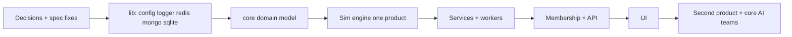

# What You're Missing

### Overview

I reviewed everything in `../../specs` plus `SCAFFOLD.md` and `AGENTS.md`. Only the `lib` specs (CONFIG, LOGGER, REDIS)
are implementation-ready. The domain specs (ECONOMY, LEAGUES, PLAYERS, SEASONS, TEAMS) are short vision notes.
`WORKERS.md` is empty and `SERVICES.md` is a sketch.

### Spec gaps

- **Games/matches**: No spec says how a game is resolved (the engine, the inputs, the randomness) or how results are
  produced. The game doesn't use physics, so this is the heart of the product.
- **Scheduling**: Nothing covers when games run, season length, schedule generation, or real time versus accelerated
  time. PLAYERS says careers are measured in "irl calendar time", so the game clock matters. There is also no spec for
  off-season, draft timing, or the "between seasons" window when teams change leagues.
- **Draft**: TEAMS says the draft is the only way to create a team. The spec doesn't say where the player pool comes
  from, the draft format, budget size, or how a new Manager gets a first team.
- **Skills and progression**: The spec doesn't define skill lists (they differ between baseball and motorsport), the
  improvement or degradation formulas, the age curves, or the "improvement plans" that ECONOMY mentions. It also doesn't
  say how the Manager and the AI make decisions: lineups, strategy, and roles.
- **Economy details**: Missing items:
    - Salary and contract model (length, renegotiation, free agency) and trade rules (who approves, the window, salary
      matching).
    - Payout tables per league tier, and how sponsorship and attendance are calculated.
    - What "budget recalculated at end of each game" means.
    - Whether the real-money balance in Membership (SERVICES) maps to credits, and what can be purchased. The "not pay
      to win" rule needs a concrete list of what is allowed.
- **Leagues**: Missing items:
    - Concrete inclusion-rule schema (skill threshold, budget, win percentage). "Regularly" is undefined.
    - Promotion and relegation ("earn your way in", and the fact that core teams are exempt).
    - League size and conferences/divisions.
    - The rules for auto-filling with AI teams, and what happens when a human team leaves.
- **Teams**: The meaning of "retired teams" and "infinite life" is unclear. Core teams are also unspecified: how many
  there are, how they build rosters, and whether they cheat.
- **Cross-product sharing**: Baseball and motorsport differ a lot. Motorsport has drivers, cars and constructors, not
  rosters. The spec doesn't say what lives in `core` and what is a product plugin.

### Platform and infrastructure gaps

- `SERVICES.md` lists Membership, Transactions, Games, History and Leagues. It doesn't cover Teams, Players or Seasons,
  and it doesn't say how services talk to each other (Redis pub/sub is likely).
- `WORKERS.md` is empty. Background jobs (season runner, game simulator, payouts) need a spec.
- Missing: a Mongo module spec and a SQLite module spec. `REDIS.md` mentions a `mongoUrl` but there is no mongo wrapper.
  There is also no spec for an Express API layer, auth (Google/Microsoft/Apple OAuth), or the Vue UI.
- Missing: testing and CI conventions, deployment and environments, and legal and privacy compliance (age limits, GDPR,
  real-money rules).
- Inconsistencies to fix:
    - `config` and `logger` use the `ETL_` prefix and `dataExtractor_etl25`, and `REDIS.md` points to
      `packages/etl-lib`. These look copy-pasted from another project and need renaming.
    - `REDIS.md` says Ubuntu only, but you are developing on Windows.
    - Config precedence is described as `config.yaml` then env then CLI, but the `config.yaml` section says "inside
      out".
    - The `../../SCAFFOLD.md` typo `mororsport`.
    - The "Atlantic Championship, Lights Championship, World Championship, and the World Championship" list has a
      duplicate name.
    - `ECONOMY.md` says "credits" while `SERVICES.md` says "real currency balances".
    - `LINTER.md` is referenced in `../../AGENTS.md` but I did not review it.

### Questions for you

1. Is this a real-time game (games play out on a wall-clock schedule) or turn-based? How long is a season in real days?
2. Do Managers interact during a game, or only between games (lineups, strategy, purchases)?
3. Which product do you want first, baseball or motorsport? The first will shape `core` abstractions, and the second
   will test them.
4. Is real money actually involved at launch, or is that deferred? It drives Membership, legal scope, and the
   Transactions design.
5. How are games simulated? Pure statistical (skills + RNG), and should results be reproducible with a seed?
6. What scale do you expect (concurrent Managers, leagues)? That decides whether services must be separate processes or
   can start as one monolith with module boundaries.
7. Is the service split (Membership, Economy, Games, History, Leagues) deployed as separate processes, or logical
   modules first?
8. Can I remove the `ETL_` prefix and rename it to something like `SBG_`?
9. Do you want a spec per product (baseball, motorsport), covering skills, rules, and terminology?

# Recommended Order

### Principles

- Build the foundation first, then a thin vertical slice of one game, then widen.
- Close the spec gaps before building each phase; don't spec everything up front.
- Prove `core` with one product before the second, so abstractions come from real use.

### Phases

1. **Housekeeping and decisions (days)**: Answer the questions above, fix the spec inconsistencies (ETL naming, typos,
   paths), and review `LINTER.md`. Write a glossary (Manager, player, team, league, season, credit, core team). Write
   ADRs in `` for the monolith-versus-services decision and the real-time-versus-turn-based decision.
2. **Lib foundations (already specified)**: Build in this order, since each depends on the previous: `config`, `logger`,
   `redis`. Then spec and build the `mongo` and `sqlite` wrappers. Set up the Makefile (test, lint, redis/mongo
   start-stop helpers) and the tapjs test harness.
3. **Core domain model**: Spec first, then build, the data models and pure logic with no I/O:
    - `players` (skills, aging, retirement)
    - `teams` and the draft
    - `economy` (credits, salaries, ledger)
    - `leagues` (rules, inclusion, tiers)
    - `seasons` and schedule generation
      Keep it product-agnostic through configuration and plugin hooks (skill sets, terminology).
4. **Game simulation engine, spiked for one product**: Define the game-resolution interface in `core`. Implement a
   baseball (or chosen product) sim as a plugin. Run seasons headless from a script, with deterministic seeds, to tune
   the economy and progression.
5. **Persistence and services**: Spec `WORKERS.md` and the inter-service messaging. Build the Games,
   Transactions/Economy, and Leagues services. Then add History, which only reads. Add the season runner worker.
6. **Membership and API**: OAuth (Google/Microsoft/Apple), Express API, permissions, and compliance basics. Real-money
   handling goes last and only if confirmed.
7. **UI**: Build `../../packages/ui` and the first product's Vue app: draft, roster, league standings, finances.
   Playtest end to end.
8. **Second product and AI/core teams**: Motorsport as a stress test of `core`. Refactor shared abstractions. Add core
   (AI) teams and league auto-fill, which need stable leagues and a sim.
9. **Hardening**: Balancing, anti-pay-to-win audit, performance, deployment.

### Dependency summary

# Delivery Steps

### Step 1: Resolve open questions and fix the specs

The ambiguities and inconsistencies in `../../specs` are resolved and recorded.

- Answer the open questions (real-time vs turn-based, first product, real money, scale).
- Rename `ETL_` and the `etl-lib` references in the CONFIG, LOGGER and REDIS specs.
- Fix typos and the duplicate league name.
- Write a glossary and ADRs in ``.
- Fill in `SERVICES.md` for Teams, Players and Seasons, and write `WORKERS.md`.

### Step 2: Build the lib foundations

`config`, `logger` and `redis` work in `../../packages/lib` with tests, and the mongo and sqlite wrappers are specified.

- Implement in order: config, logger, redis.
- Add Makefile targets for tests and local service start/stop.
- Write specs for the mongo and sqlite wrappers, then implement them.

### Step 3: Spec and build the core domain model

`../../packages/core` has product-agnostic players, teams, draft, economy, leagues and seasons.

- Write the missing detail specs first: skills and aging, draft, salary and trades, league rules, scheduling.
- Implement the pure logic with tests, and define the plugin interface for products.

### Step 4: Spike one product with a headless simulation

One product (baseball or the Manager's pick) runs full seasons from a script.

- Define the game-resolution interface and implement the sim with seeded RNG.
- Use the results to tune economy and progression before building services or UI.

### Step 5: Services, API, UI, then second product

The first product is playable end to end, and the second product validates `core`.

- Build services and workers, then Membership/OAuth and the Express API.
- Build the Vue UI.
- Add motorsport, core AI teams and league auto-fill, then harden.